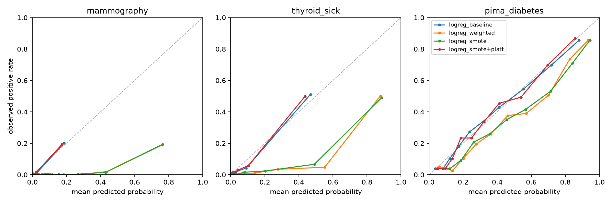

# imbalanced-benchmarks

Systematic comparison of techniques for class-imbalanced classification on real datasets, including medical ones.

When 2% of samples are positive, accuracy is a misleading metric and standard training under-serves the minority class — usually the class that matters (disease, failure, fraud). This benchmark compares the common remedies under one consistent evaluation protocol: stratified cross-validation, scored with metrics that remain informative under imbalance (PR-AUC, balanced accuracy, F1, recall).

## Methods compared

- **Baseline** — untreated logistic regression and random forest
- **Cost-sensitive weighting** — `class_weight="balanced"` (misclassification costs inversely proportional to class frequency)
- **Oversampling** — SMOTE
- **Undersampling** — random majority undersampling

## Datasets

| Dataset | Domain | Positive class |
|---|---|---|
| mammography | medical imaging follow-up | ~2.3% |
| thyroid_sick | clinical thyroid screening | ~6% |
| pima diabetes | clinical tabular | ~35% (mild-imbalance contrast) |

## Usage

```
pip install -r requirements.txt
python -m benchmark.run          # writes results/results.csv and prints a summary table
python -m benchmark.calibration  # writes results/calibration.csv and results/reliability.png
```

## Results

PR-AUC, 5-fold stratified CV (seed 42, scikit-learn 1.9). Full metrics with fold std in `results/results.csv`.

| Method | mammography | thyroid_sick | pima_diabetes |
|---|---|---|---|
| logreg_baseline | 0.618 | 0.702 | 0.723 |
| logreg_weighted | 0.547 | 0.655 | **0.725** |
| logreg_smote | 0.541 | 0.644 | 0.723 |
| forest_baseline | **0.755** | 0.952 | 0.687 |
| forest_weighted | 0.736 | **0.952** | 0.693 |
| forest_smote | 0.711 | 0.945 | 0.682 |
| forest_undersample | 0.643 | 0.865 | 0.688 |

Takeaways from this run:

- Ranked by PR-AUC alone, untreated baselines look best — but that hides the operating point. The treatments buy **recall**: on thyroid_sick, `forest_weighted` matches the baseline's PR-AUC (0.952) while lifting recall from 0.78 to 0.89; on mammography, weighting lifts logistic-regression recall from 0.42 to 0.85 at a real precision cost.
- Undersampling is the bluntest instrument: highest recall everywhere (0.89–0.95 on the two rare-positive datasets), paid for with the largest F1/PR-AUC drops.
- On mildly imbalanced pima_diabetes (35% positive), all methods land within noise of each other — imbalance treatments matter when imbalance is severe.

## Calibration after treatment

Every treatment above changes the class balance the model sees in training, so its predicted probabilities stop matching the real positive rate. `benchmark/calibration.py` measures this on pooled out-of-fold predictions (same 5-fold split, seed 42) and tests a fix: sigmoid (Platt) recalibration fitted inside each training fold with an inner 3-fold split, so the test fold never sees it. The untreated baselines are recalibrated too, as a control. Without that control, any gain from "treatment + Platt" could simply come from Platt scaling smoothing the scores.

Mean predicted probability against the real positive rate, and Brier score (lower is better):

| Method | mammography mean p | Brier | thyroid_sick mean p | Brier |
|---|---|---|---|---|
| *real positive rate* | *0.023* | | *0.061* | |
| logreg_baseline | 0.023 | 0.0131 | 0.061 | 0.0283 |
| logreg_weighted | 0.213 | 0.0821 | 0.197 | 0.0809 |
| logreg_smote | 0.203 | 0.0790 | 0.171 | 0.0714 |
| forest_undersample | 0.190 | 0.0682 | 0.191 | 0.0465 |
| logreg_baseline+platt | 0.023 | 0.0131 | 0.062 | 0.0290 |
| logreg_weighted+platt | 0.024 | 0.0145 | 0.062 | 0.0321 |
| logreg_smote+platt | 0.024 | 0.0146 | 0.062 | 0.0318 |
| forest_baseline+platt | 0.023 | 0.0105 | 0.061 | 0.0132 |
| forest_weighted+platt | 0.023 | 0.0110 | 0.061 | 0.0122 |
| forest_undersample+platt | 0.023 | 0.0129 | 0.061 | 0.0170 |

All 42 rows (every method, with and without Platt, on all three datasets, plus ECE, log loss and PR-AUC) are in `results/calibration.csv`. Reliability curves for the logistic-regression variants are in `results/reliability.png`.



Takeaways from this run:

- The distortion is large where imbalance is severe. On mammography, where 2.3% of cases are positive, class weighting and SMOTE make logistic regression predict an average risk of 21% and 20%, about nine times too high, and the Brier score gets six times worse. Undersampling does the same to the random forest (19%).
- Platt recalibration puts the average prediction back on the real rate in every case and recovers most of the Brier loss.
- Against the recalibrated baselines, the treatments rarely come out ahead. For logistic regression, no treatment beats the untreated model on any dataset, with or without recalibration. For the random forest, weighting + Platt beats baseline + Platt on thyroid_sick (0.0122 against 0.0132), is close on pima_diabetes (0.1585 against 0.1592), and is worse on mammography (0.0110 against 0.0105).
- Platt scaling is monotone for a single model, but the calibrated model here averages three copies trained on two thirds of the data each, so PR-AUC moves by up to about 0.02 in either direction.
- PR-AUC in `calibration.csv` is computed on pooled out-of-fold predictions, so it differs slightly from the fold-averaged numbers in the first table.
- Practical reading: the raw scores of a weighted or resampled model should not be reported as risks. If calibrated probabilities matter, recalibrate, or keep the untreated model and choose the decision threshold from the costs instead.

## Roadmap

- [ ] cost-sensitive SVM formulations
- [x] probability calibration after resampling
- [ ] missing-value handling strategies
